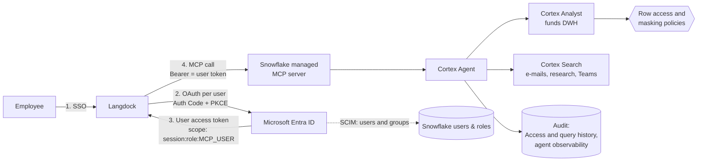

# Langdock → Snowflake Cortex Agent: per-user identity architecture

> Reference architecture and test notes, provided as-is. Not an official Snowflake or Langdock product; validate in your own environment.

**Goal:** Every question asked in Langdock reaches Snowflake as the signed-in employee, not as a shared service account. Snowflake then applies that person's data permissions and records their activity.

## Architecture



```
 Employee
    │ 1. SSO
    ▼
 ┌──────────┐  2. OAuth per user (Auth Code+PKCE)  ┌──────────────────┐
 │ Langdock │ ───────────────────────────────────► │ Microsoft Entra  │
 │          │ ◄─────────────────────────────────── │ ID               │
 └────┬─────┘  3. User token                       └────────┬─────────┘
      │           (session:role:MCP_USER)               │ SCIM
      │ 4. MCP call, Bearer = user token                    │ users+groups
      ▼                                                     ▼
 ┌─────────────────────────── Snowflake ───────────────────────────────┐
 │  External OAuth (Entra only) ─► session = employee + MCP_USER   │
 │        │                                                            │
 │        ▼                                                            │
 │  MCP server ─► Cortex Agent ─┬─► Cortex Analyst ─► Row access +     │
 │                              │   (funds DWH)       masking per user │
 │                              └─► Cortex Search (one service per     │
 │                                  access domain)                     │
 │  Audit: ACCESS_HISTORY · QUERY_HISTORY · agent observability        │
 └─────────────────────────────────────────────────────────────────────┘
```

## How the user identity is passed through

1. **Sign-in.** The employee signs in to Langdock with Entra ID SSO, as today.
2. **Per-user connection.** The Snowflake connector in Langdock uses OAuth 2.0 (Authorization Code + PKCE) against Entra ID. Each employee connects once, usually silently. Entra issues an access token in that employee's name.
3. **Token to Snowflake.** Langdock sends the employee's token with each call to the Snowflake MCP server.
4. **Validation.** Snowflake accepts only tokens from the organisation's Entra tenant, through an External OAuth integration bound to the MCP server. It maps each token to the matching Snowflake user.
5. **Session as the employee.** The session runs as that employee, with one least-privileged role (`MCP_USER`). The session is flagged as an AI agent session.

No password, key or service account is stored for data access.

**Langdock connector settings ("OAuth 2.0 Manual"):**

| Setting | Value |
|---|---|
| Server URL | `https://<account>.snowflakecomputing.com/api/v2/databases/<db>/schemas/<schema>/mcp-servers/<name>` |
| Authorization / Token URL | `https://login.microsoftonline.com/<tenant>/oauth2/v2.0/authorize` and `.../token` |
| Scope | `api://<snowflake-app-id>/session:role:MCP_USER offline_access` |
| Send resource parameter | Off (Entra ID) |
| Custom header | `X-Snowflake-Role: MCP_USER`, or set each user's `DEFAULT_ROLE` to `MCP_USER` |

## Identity and permissions

| Topic | Approach |
|---|---|
| Users and groups | Entra ID SCIM provisioning creates the Snowflake users and roles automatically and keeps them in sync |
| Fund and department access | An entitlement table (employee → fund / department) is evaluated by row access policies on `CURRENT_USER()`. Existing Postgres and SQL Server permissions can be migrated into this table. |
| Sensitive columns | Masking policies. They can also mask differently when access comes through the AI agent. |
| Structured data (Cortex Analyst) | Queries run as the employee, so row access and masking apply automatically |
| Unstructured data (Cortex Search) | A search service returns everything it indexed to anyone allowed to use it. Snowflake does not build a search service over a table whose row access policy depends on the user. Services are therefore split by access domain (for example per department), and access to each service is granted by role. |
| Privileged roles | ACCOUNTADMIN and SECURITYADMIN are blocked for OAuth by default. Only `MCP_USER` is allowed. |

## Audit (BaFin / DORA)

- **Who accessed which data:** `ACCESS_HISTORY` and `QUERY_HISTORY` record each query under the employee's name and role, marked as agent activity.
- **Prompts and answers:** Cortex Agent threads and observability in Snowflake, plus Langdock's chat logs.
- **Logins:** `LOGIN_HISTORY` records each External OAuth sign-in.

## Network and resilience

- **Network:** Snowflake network policies allow only Langdock's outbound IP addresses on the MCP endpoint. Private Link to Azure is available for internal access (Business Critical).
- **Failover:** Users, roles, policies and security integrations replicate to the secondary account (Business Critical). **MCP server objects are not replicated by failover groups** ([Snowflake docs](https://docs.snowflake.com/en/user-guide/snowflake-cortex/cortex-agents-mcp)). They are kept in a small local database with the same name on both accounts (`MCP_LOCAL.MCP`), because replicated databases are read-only on the secondary. A scheduled task on the primary recreates them on the secondary through the SQL API and an External Access Integration. Sample: `mcp_dr_sync_to_secondary.sql`.
  - **Authentication of the sync job:** Entra ID client credentials. Snowflake fetches a short-lived Entra token for a dedicated sync app (API authentication integration); the secondary maps that app to a service user with only the right to create MCP servers. No long-lived token is stored, and the client secret is rotated and revoked in Entra. A programmatic access token (PAT) works as a simpler alternative.
  - **Tool targets:** `CREATE MCP SERVER` does not check that the referenced Cortex Agent or search service exists. The sync job checks each target on the secondary first and skips the server if one is missing; those objects arrive through the failover group.
  - **Monitoring:** any skipped server or failed call fails the task run, so it shows in task history and can raise a notification.
  - **Network:** the secondary's network policy for the sync user allows the primary's Snowflake egress ranges (`SYSTEM$GET_SNOWFLAKE_EGRESS_IP_RANGES()`).

## Validated in a test environment

Tested end to end with a real Entra ID user. A confidential OAuth client was set up the way Langdock's "OAuth 2.0 Manual" connector is: browser sign-in, Authorization Code + PKCE, client secret, and a refresh token.

| Check | Result |
|---|---|
| **Langdock (SaaS) "OAuth 2.0 Manual" connector → Entra ID → Snowflake MCP:** Langdock's backend calls Snowflake with the employee's own token | ✅ |
| Langdock chat → Cortex Agent → Cortex Analyst: query ran as the employee with role `MCP_USER`, from Langdock's IP, and returned only the employee's fund | ✅ |
| Langdock answer also mentioned a non-entitled fund's research note (via Cortex Search) | ⚠️ Expected; split search services by access domain |
| Second employee, **own connection**: Snowflake saw their own Entra identity and returned only their fund | ✅ |
| Second employee, **shared Langdock agent with a pre-selected owner connection**: query ran as the agent owner and returned the owner's fund | ⚠️ Shared agents are set to "users choose their own connection" (Langdock default); no pre-selected connections |
| Snowflake network policy must allow Langdock's egress IPs (user-, integration- or account-level) | ⚠️ Configuration item |
| Audit: `QUERY_HISTORY` and `ACCESS_HISTORY` record each agent query under the employee's name, with the Cortex Agent and `EXTERNAL_AGENT` in `AGENTS_INFO`, the table read and the row access policy applied | ✅ |
| MCP DR sync: a task on the primary recreated the MCP server on a second account through the SQL API and an External Access Integration (identical spec, `USAGE` granted) | ✅ |
| MCP DR sync with **Entra client credentials** (no stored token): the secondary recorded the login as `OAUTH_ACCESS_TOKEN` from the primary's egress IP, running as the sync service user | ✅ |
| `CREATE MCP SERVER` accepted a tool whose Cortex Agent did not exist on the secondary | ⚠️ The sync job checks targets first; tested: server skipped and task run failed |
| Browser sign-in (Auth Code + PKCE, confidential client) issues a user token with scope `session:role:MCP_USER` and a refresh token | ✅ |
| Refreshed token keeps working with the MCP server, without the user signing in again | ✅ |
| MCP server advertises Entra ID as its authorization server (RFC 9728 discovery) | ✅ |
| Entra v2 user token accepted; session = the employee, role `MCP_USER` | ✅ |
| Without a role header, the user's default role is used and the call is rejected (`390317`) | ⚠️ Set the role header or `DEFAULT_ROLE` |
| Cortex Agent → Cortex Analyst: row access policy returned only the employee's fund | ✅ |
| Cortex Search: returned notes for a fund the employee is not entitled to | ⚠️ Expected; split services by access domain |
| `QUERY_HISTORY` shows the agent's SQL under the employee's name and role | ✅ |

## Common questions

| # | Question | Short answer |
|---|---|---|
| 1 | Entra groups → Snowflake roles, kept in sync? | Entra SCIM provisioning creates the users and roles and syncs changes automatically |
| 2 | Reproduce fund and department permissions? | Yes. An entitlement table plus row access and masking policies; the existing permissions can be loaded into it |
| 3 | Langdock as the signed-in user, not a service account? | Yes. Langdock's per-user OAuth connection to Entra ID; scope `session:role:MCP_USER`; one least-privileged role |
| 4 | What if the client can't pick a role? | Not needed. Every user gets the same MCP role, and per-user data access comes from policies on `CURRENT_USER()` |
| 5 | Do row access and masking apply to the agent? | Cortex Analyst: yes, as the user. Cortex Search: access is controlled per search service, so services are split by access domain |
| 6 | Audit of prompts, answers and data accessed? | Access and query history per user (marked as agent activity), Cortex Agent observability, Langdock chat logs |
| 7 | Authentication, MCP and agents in failover? | Users, roles, policies and integrations replicate. MCP server objects do not replicate; a task on the primary recreates them on the secondary, authenticated with Entra client credentials (tested; sample script provided). One connection URL (Client Redirect) is the stable endpoint for Langdock and the token audience. |
| 8 | What needs Business Critical? | Failover / Client Redirect, Private Link to Azure, Tri-Secret Secure (customer-managed key) |

## Points to confirm in the proof of concept

Confirmed in testing: per-user passthrough, Entra token and scope settings (resource parameter off), role header, refresh, row access per user, shared-agent behaviour, and the Snowflake audit trail.

Confirmed or covered by existing capabilities:

- **SCIM provisioning:** Entra groups → Snowflake users and roles, including deprovisioning.
- **Masking:** masking policies are evaluated in the same session as row access policies, so they apply in the same way.
- **Failover:** users, roles, policies and integrations replicate; MCP servers are recreated on the secondary by the sync task (tested between two accounts); Langdock connects through the Client Redirect URL. A full failover drill is part of the PoC.

Design points:

- **Cortex Search:** a search service always runs with its owner's rights, so row access policies on the source tables do not filter results per user. Content is split into separate search services per access domain, with access granted by role.
- **Langdock audit and retention:** Langdock admins set chat retention (7 days to forever) under Workspace Settings → Chat → Data Retention; agent tracing is available through Langfuse. The organisation checks these against BaFin/DORA requirements in Langdock's documentation.
- **Langdock governance:** whether shared agents may use pre-selected Snowflake connections is the organisation's decision. The option is visible in Langdock, which warns that anyone using such an agent acts through the owner's connected account.

Still to confirm:

- **Network policy:** Langdock's published egress IP ranges, set as a network policy on the Entra External OAuth integration.

---

## Agent governance: inventory, sensitive data, usage, error rates

Internal audit teams used to governed AI platforms typically ask for four things. All four can be answered from Snowflake system views today, using `sql/03_agent_governance.sql` (tested on a live account).

| Audit question | Source | Tested result |
|---|---|---|
| **Agent inventory** | `SHOW AGENTS IN ACCOUNT`, `SHOW MCP SERVERS IN ACCOUNT` (+ `SHOW GRANTS ON AGENT`) | All agents and MCP servers listed with database, schema, owner, created date and comment ✅ |
| **Which agents touch which data** | `ACCOUNT_USAGE.ACCESS_HISTORY.AGENTS_INFO` joined to `BASE_OBJECTS_ACCESSED`, `POLICIES_REFERENCED` and `TAG_REFERENCES` | Per agent: tables, columns, distinct users, whether the call came through an external client (Langdock/MCP shows as `EXTERNAL_AGENT`), and whether a row access policy applied ✅ |
| **Usage per agent** | `SNOWFLAKE.LOCAL.AI_OBSERVABILITY_EVENTS` (agent traces), `ACCOUNT_USAGE.QUERY_HISTORY.AGENT_TYPE` | Requests, distinct users, p95 latency and last use per agent; agent-issued SQL per user and role ✅ |
| **Error rate per agent** | `AI_OBSERVABILITY_EVENTS`, request span `AgentV2RequestResponseInfo` | Agent with a broken tool: 3 of 3 requests counted as errors (100 %), healthy agents 0 %, with an error breakdown by code ✅ |

Findings from the test:

- **Tool failures do not appear in the request status.** When a tool failed (its semantic view was dropped), the request still reported status `SUCCESS` and the agent answered "I can't answer this…". The failure is recorded only in `snow.ai.observability.agent.warnings` (code `399569 TOOL_NOT_ACCESSIBLE`). Error rates therefore count requests with a non-success status **or** warnings.
- **Failures that never reach SQL** (missing tool, no access) are not visible in `QUERY_HISTORY`; the agent traces are the source for error rates. `QUERY_HISTORY` covers failed SQL issued by agents.
- **External callers are visible:** queries from Langdock through the MCP server carry both the Cortex Agent and `EXTERNAL_AGENT` in `AGENTS_INFO`, under the real user.
- **Sensitive data** is identified by joining the columns an agent read (`ACCESS_HISTORY.BASE_OBJECTS_ACCESSED`) to column tags (custom tags or classification tags such as `SNOWFLAKE.CORE.SEMANTIC_CATEGORY`). Tested: an agent's reads of a client table came back with `IBAN` and `CLIENT_NAME` as `CONFIDENTIAL`, `SEGMENT` as `PUBLIC` and an untagged key column as untagged. `ACCOUNT_USAGE.TAG_REFERENCES` has latency (up to ~2 h), and tags on objects dropped before it caught up never appeared there; for a live check per table use `INFORMATION_SCHEMA.TAG_REFERENCES_ALL_COLUMNS` (query 2b).
- **Latency:** `AI_OBSERVABILITY_EVENTS` had the requests within about a minute; `ACCESS_HISTORY` within minutes in this test (documented latency up to ~3 h).
- **Agent data metric functions** (`SNOWFLAKE.CORE.AGENT_ERROR_RATE`, `AGENT_LATENCY_P95`) were not available on the test account; the queries above do not depend on them.
- The test ran as `ACCOUNTADMIN`. For a production dashboard, a dedicated audit role needs `ACCOUNT_USAGE` access and access to the agent traces; check the required privileges in the Snowflake documentation.

These queries can back a Snowsight dashboard or a small Streamlit app; a packaged, supported dashboard is not part of this repository.

## Appendix: setup and test steps

These are the steps used in the test environment. Values in `<angle brackets>` are environment-specific. The SQL runs as `ACCOUNTADMIN` (or an equivalent admin role).

### A. Entra ID

1. **Snowflake resource app** (represents Snowflake as an API):
   - App registration → *Expose an API* → Application ID URI `api://<snowflake-app-id>`.
   - Add the delegated scope `session:role:MCP_USER` (admins and users can consent).
   - In the manifest, set `"requestedAccessTokenVersion": 2` (v2 tokens, issuer `https://login.microsoftonline.com/<tenant>/v2.0`).
2. **Langdock client app** (confidential client):
   - App registration → *Authentication* → Web redirect URI `https://app.langdock.com/api/integrations/<langdock-integration-id>/callback` (Langdock shows this URL when the integration is created).
   - *Certificates & secrets* → new client secret.
   - *API permissions* → add the delegated permission `session:role:MCP_USER` from the Snowflake app → grant admin consent.
3. **Users:** each employee signs in with their own Entra account. Their `preferred_username` (UPN) has to match the Snowflake user's `LOGIN_NAME`; SCIM provisioning does this automatically.

### B. Snowflake

```sql
-- 1. Entra as External OAuth provider, marked as an agent integration
CREATE SECURITY INTEGRATION ENTRA_MCP_V2
  TYPE = EXTERNAL_OAUTH  ENABLED = TRUE  EXTERNAL_OAUTH_TYPE = AZURE
  EXTERNAL_OAUTH_ISSUER = 'https://login.microsoftonline.com/<tenant>/v2.0'
  EXTERNAL_OAUTH_JWS_KEYS_URL = 'https://login.microsoftonline.com/<tenant>/discovery/v2.0/keys'
  EXTERNAL_OAUTH_AUDIENCE_LIST = ('<snowflake-app-id>')
  EXTERNAL_OAUTH_TOKEN_USER_MAPPING_CLAIM = 'preferred_username'
  EXTERNAL_OAUTH_SNOWFLAKE_USER_MAPPING_ATTRIBUTE = 'LOGIN_NAME'
  EXTERNAL_OAUTH_ALLOWED_ROLES_LIST = ('MCP_USER')
  IS_AGENTIC = TRUE;

-- 2. One least-privileged role for all Langdock users
CREATE ROLE MCP_USER;
GRANT ROLE MCP_USER TO ROLE <entra_group_role>;      -- SCIM-provisioned group role

-- 3. Entitlements and row access policy (per user, not per role)
CREATE TABLE DATA.USER_FUND_ENTITLEMENT (login_name STRING, fund_id STRING);
CREATE ROW ACCESS POLICY DATA.RAP_FUND AS (f STRING) RETURNS BOOLEAN ->
  EXISTS (SELECT 1 FROM DATA.USER_FUND_ENTITLEMENT e
          WHERE e.login_name = CURRENT_USER() AND e.fund_id = f);
ALTER TABLE DATA.FUNDS ADD ROW ACCESS POLICY DATA.RAP_FUND ON (fund_id);

-- 4. Semantic view, search service (one per access domain), agent
--    (test versions: test/setup.sql)

-- 5. MCP server, bound to Entra
CREATE MCP SERVER MCP_LOCAL.MCP.RESEARCH FROM SPECIFICATION $$
tools:
  - title: "Research agent"
    name: "research_agent"
    type: "CORTEX_AGENT_RUN"
    identifier: "<db>.DATA.RESEARCH_AGENT"
    description: "Governed fund and research questions"
$$;
ALTER SCHEMA MCP_LOCAL.MCP SET
  OAUTH_AUTHORIZATION_SERVER = ENTRA_MCP_V2
  OAUTH_SCOPES_SUPPORTED = 'session:role:MCP_USER';

-- 6. Grants for the MCP role
GRANT DATABASE ROLE SNOWFLAKE.CORTEX_AGENT_USER TO ROLE MCP_USER;
GRANT USAGE ON WAREHOUSE <wh> TO ROLE MCP_USER;
GRANT USAGE ON DATABASE / SCHEMA ... TO ROLE MCP_USER;
GRANT USAGE ON MCP SERVER MCP_LOCAL.MCP.RESEARCH TO ROLE MCP_USER;
GRANT USAGE ON AGENT <db>.DATA.RESEARCH_AGENT TO ROLE MCP_USER;
GRANT USAGE ON CORTEX SEARCH SERVICE <db>.DATA.<search_svc> TO ROLE MCP_USER;
GRANT SELECT ON SEMANTIC VIEW <db>.DATA.FUNDS_SV TO ROLE MCP_USER;
GRANT SELECT ON TABLE <db>.DATA.FUNDS TO ROLE MCP_USER;

-- 7. Network: allow Langdock's egress IPs on the integration
CREATE NETWORK RULE LANGDOCK_EGRESS TYPE = IPV4 MODE = INGRESS VALUE_LIST = ('<langdock_ips>');
CREATE NETWORK POLICY LANGDOCK_ONLY ALLOWED_NETWORK_RULE_LIST = ('LANGDOCK_EGRESS');
ALTER SECURITY INTEGRATION ENTRA_MCP_V2 SET NETWORK_POLICY = LANGDOCK_ONLY;
```

MCP server URL for Langdock:
`https://<org>-<account>.snowflakecomputing.com/api/v2/databases/MCP_LOCAL/schemas/MCP/mcp-servers/RESEARCH`
(with failover, use the Client Redirect connection URL as the host).

### C. Langdock

1. *Integrations* → *Add MCP server* → URL from above → authentication **OAuth 2.0 Manual**.
2. Fill in the values from the "Langdock connector settings" table above (Entra authorize and token URLs, client ID and secret, scope, **Send resource parameter off**, header `X-Snowflake-Role: MCP_USER`).
3. Share the integration with the workspace, so every employee can connect **their own** account.
4. Agents: add the MCP tool and leave *Pre-select a connection* empty, so each user acts as themselves.

### D. How we tested

| Test | Steps | Expected / observed |
|---|---|---|
| Passthrough | Employee 1 connects in Langdock (Entra sign-in), asks "Which funds and AUM can I see?" | Answer lists only their entitled fund |
| Second user | Employee 2 (different entitlement) connects their own account in a separate browser and asks the same question | Only employee 2's fund |
| Shared agent | Agent owner pre-selects their connection; employee 2 uses the agent | Runs as the owner (shows why pre-selected connections are a governance decision) |
| Role header | Call without `X-Snowflake-Role` for a user whose default role differs | Error `390317`; with the header it works |
| Cortex Search | Ask about research notes | Search returns notes regardless of user, so services are split by access domain |
| Network policy | Without Langdock's IPs allowed | Error `390422`; works after adding the IPs |
| Refresh | Wait for the access token to expire (~1 h) and ask again | Works without signing in again |
| DR sync | `CALL ...SYNC_MCP_SERVERS_TO_SECONDARY(...)` from `mcp_dr_sync_to_secondary.sql`, then `SHOW MCP SERVERS` on the secondary | Server present, owner `MCP_DEPLOYER`, `USAGE` granted; with a missing agent the server is skipped and the run fails |

**Evidence queries in Snowflake** (run after the Langdock chats):

```sql
-- Who ran which agent query, with which role, from where
SELECT user_name, role_name, start_time, agent_type, LEFT(query_text, 80) AS q
FROM TABLE(INFORMATION_SCHEMA.QUERY_HISTORY(
       END_TIME_RANGE_START => DATEADD('hour', -2, CURRENT_TIMESTAMP()), RESULT_LIMIT => 10000))
WHERE role_name = 'MCP_USER'
ORDER BY start_time DESC;

SELECT user_name, event_timestamp, client_ip, first_authentication_factor, is_success, error_message
FROM TABLE(INFORMATION_SCHEMA.LOGIN_HISTORY(DATEADD('hour', -2, CURRENT_TIMESTAMP()), CURRENT_TIMESTAMP()))
WHERE first_authentication_factor = 'OAUTH_ACCESS_TOKEN'
ORDER BY event_timestamp DESC;

-- Data accessed, agent attribution and policies applied (ACCOUNT_USAGE, up to ~3 h latency)
SELECT query_start_time, user_name, agents_info, direct_objects_accessed, policies_referenced
FROM SNOWFLAKE.ACCOUNT_USAGE.ACCESS_HISTORY
WHERE query_start_time > DATEADD('day', -1, CURRENT_TIMESTAMP())
  AND agents_info IS NOT NULL
ORDER BY query_start_time DESC;
```

Expected: `user_name` is the employee (not a service user), `role_name` is `MCP_USER`, `client_ip` is Langdock's egress IP, `agents_info` lists the Cortex Agent and `EXTERNAL_AGENT`, and `policies_referenced` shows the row access policy.

### E. Repository contents

- `sql/01_demo_setup.sql`: demo data, row access policy, semantic view, search service, agent, MCP server and grants.
- `sql/02_evidence.sql`: audit queries for identity, role, source IP, agent attribution and policies.
- `sql/03_agent_governance.sql`: agent inventory, data touched per agent (with tags and policies), usage and error rate per agent.
- `sql/mcp_dr_sync_to_secondary.sql`: DR sync of MCP servers to a secondary account (PAT option and Entra client-credentials option).
- `scripts/mcp_as_user.py`: calls the MCP server with a user token (optional `X-Snowflake-Role`), without Langdock.
- `scripts/langdock_sim_pkce.py`: simulates Langdock's OAuth 2.0 Manual flow (browser sign-in, Auth Code + PKCE, refresh) on `localhost:8765`.

Configuration for the scripts comes from environment variables; see `.env.example`.
