# Icedock

Icedock is a local chat, agents and MCP integrations app modelled on the Langdock UI and UX, built to keep testing the Entra ID → Snowflake MCP per-user passthrough after the Langdock trial ended. Python (FastAPI) backend, Preact (Vite) frontend, managed with pixi.

> **Demo purposes only.** The UI exists only to demonstrate and test the identity flow (Entra ID SSO, per-user OAuth to the Snowflake MCP server, row access by user) without a Langdock licence. It is not a product, not hardened, and not meant for production or real data. Provided as-is; not affiliated with Langdock.

## What it recreates

| Langdock feature | Icedock |
|---|---|
| Entra ID SSO sign-in | `/auth/login`: Authorization Code + PKCE, confidential client. The first user to sign in becomes admin |
| Chat with a model picker, streaming, Markdown, copy and regenerate | Models are Snowflake Cortex models, called through `/api/v2/cortex/v1/chat/completions` **with the signed-in user's token** |
| Chat history: search, rename, pin, delete | Sidebar |
| Tools in chat | "Tools" menu: enable integrations per chat; tool-call cards show input, output and **which identity ran the call** |
| Integrations → Add MCP server | Auth: none, shared API key, or **OAuth 2.0 Manual** (auth/token URL, client ID/secret, scope, *send resource parameter*, custom headers), shared with workspace |
| Per-user "Connect" | Popup OAuth flow; each member connects their own account. Tool discovery (`tools/list`) and a tool tester |
| "Connect to continue" in chat | If a tool needs a connection the user doesn't have, the chat shows a Connect card and retries after sign-in |
| Agents | Emoji, name, description, instructions, model, conversation starters, actions (selected MCP tools), private or workspace |
| Agent "Pre-select a connection" | The owner can pin their own connection; everyone using the agent then acts as the owner (shown with a warning and a badge) |
| Workspace settings | Name, available models, default model, members and admin role, audit log, account/token view |

Tokens and client secrets are encrypted at rest (Fernet, key derived from `SESSION_SECRET`) in `icedock/data/icedock.db`. Access and refresh tokens are refreshed automatically.

## Screenshots

Demo UI only. Captured during the end-to-end test on 12 Nov 2026. Names, e-mail addresses, account URL and tenant/app/client IDs are blurred (`docs/blur_for_screenshots.js`).

**Sign-in with Microsoft Entra ID**

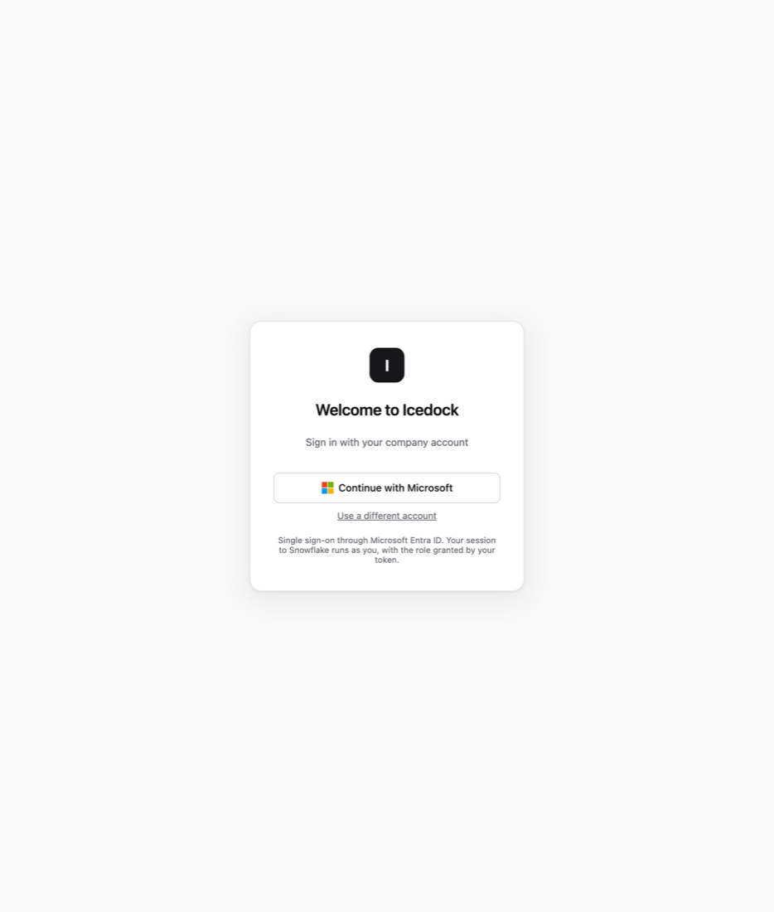

**Agent chat: the tool card shows the MCP call, its input and output, and the identity it ran as**

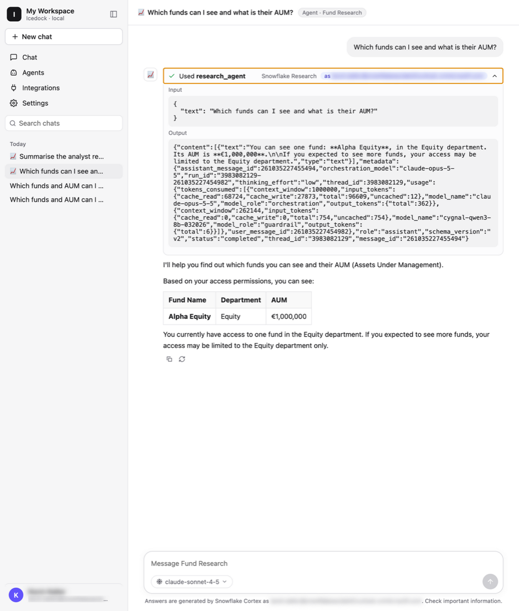

**Row access applied: only Alpha Equity is visible; the tool ran as KELLER with role LDC_MCP_USER**

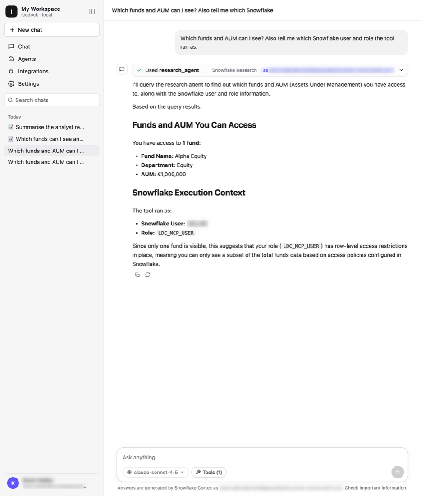

**Cortex Search caveat: research notes are not row-filtered, so the Secret Beta note is returned**

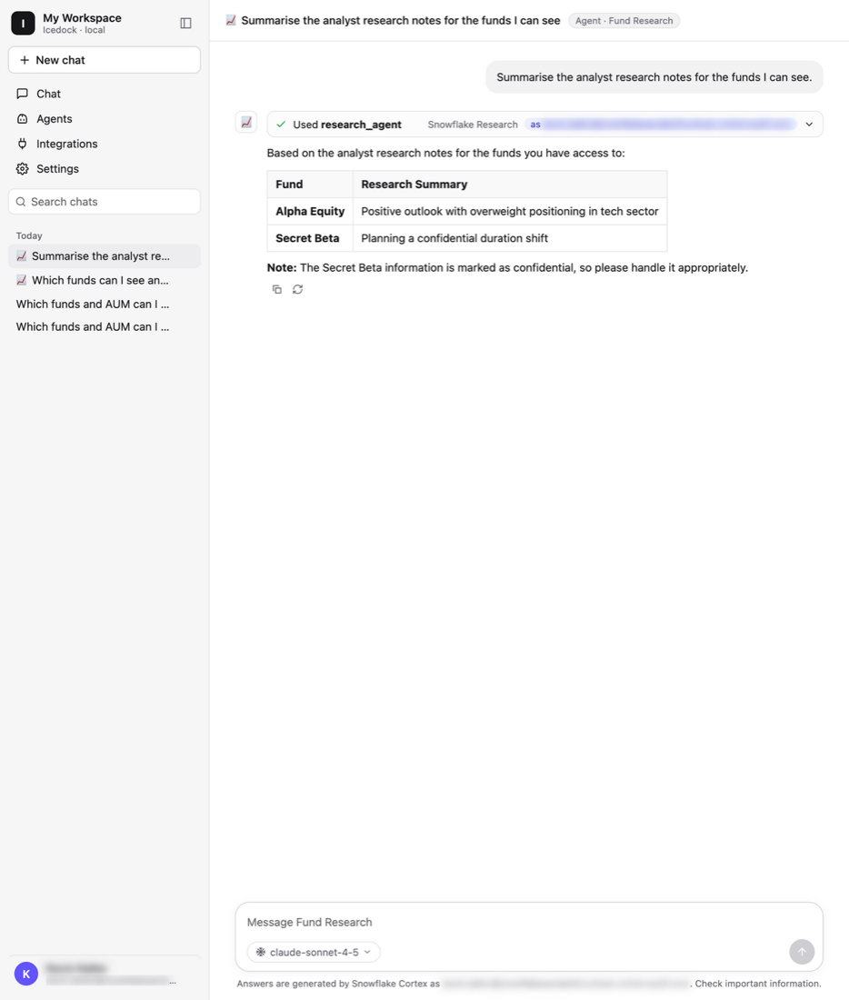

**Integrations: Snowflake MCP server, connected per user, with discovered tools**

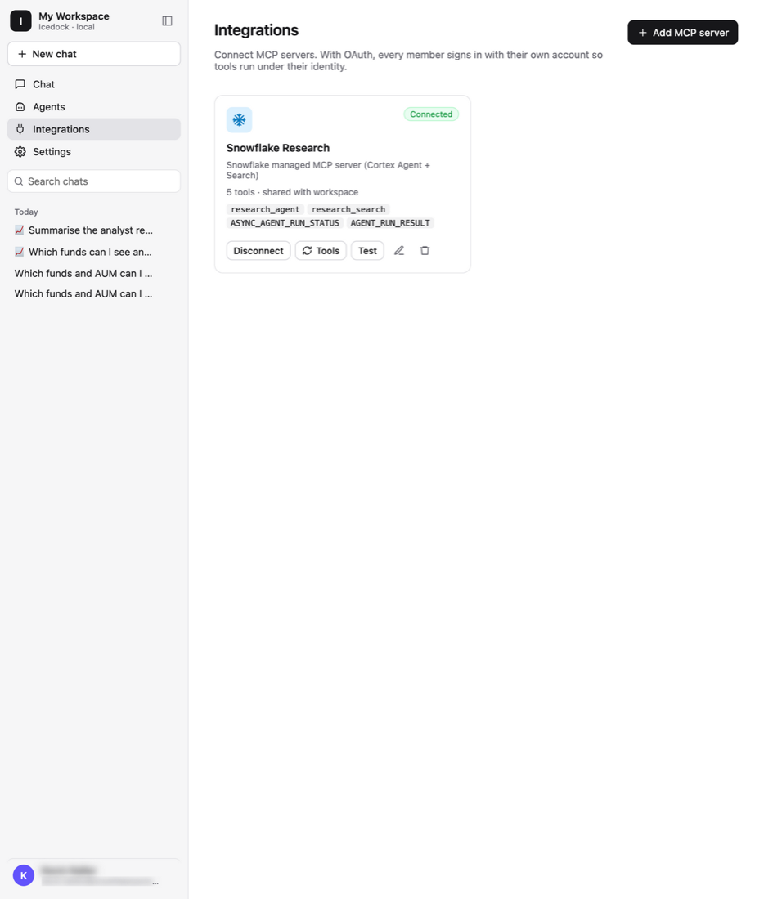

**OAuth 2.0 Manual settings, as in the Langdock connector (resource parameter off, X-Snowflake-Role header)**

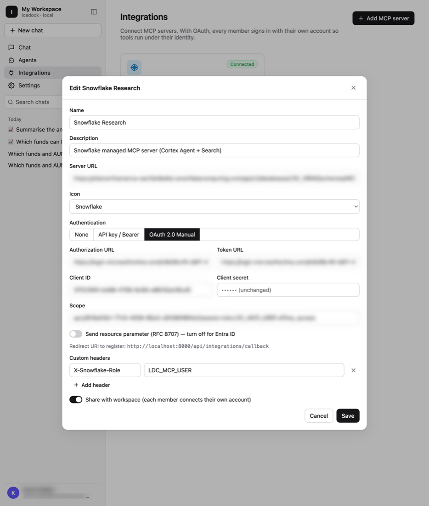

**Agents list**

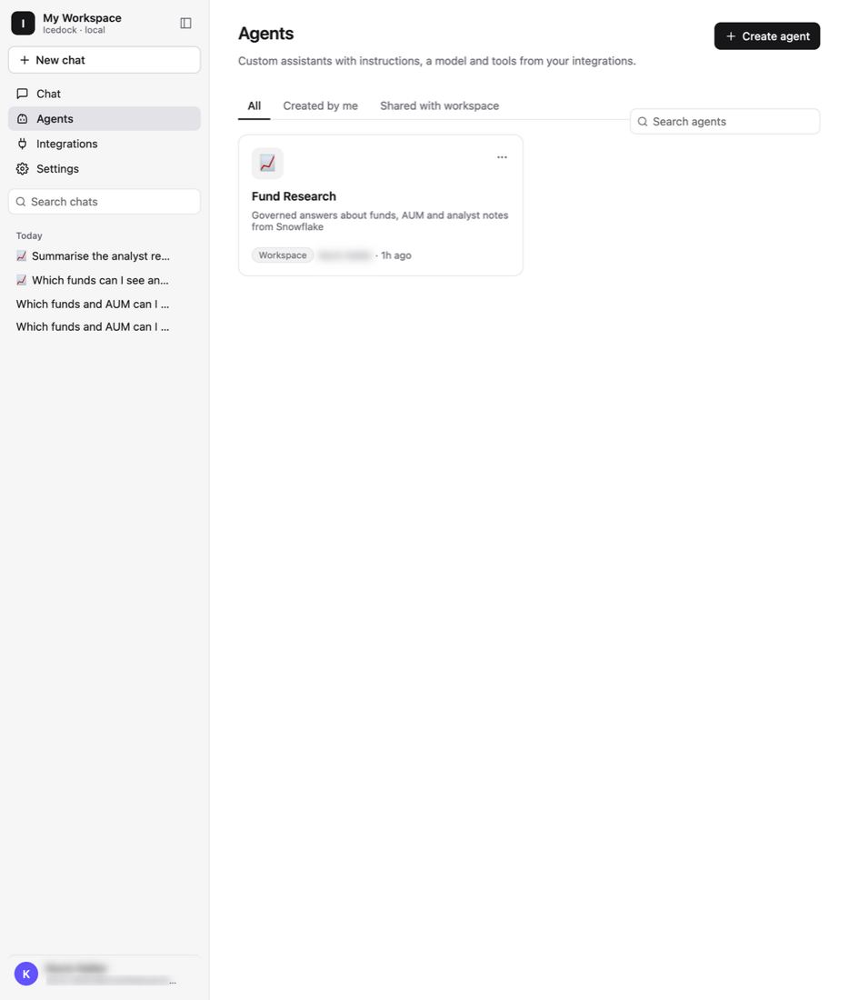

**Agent configuration: instructions, model, conversation starters**

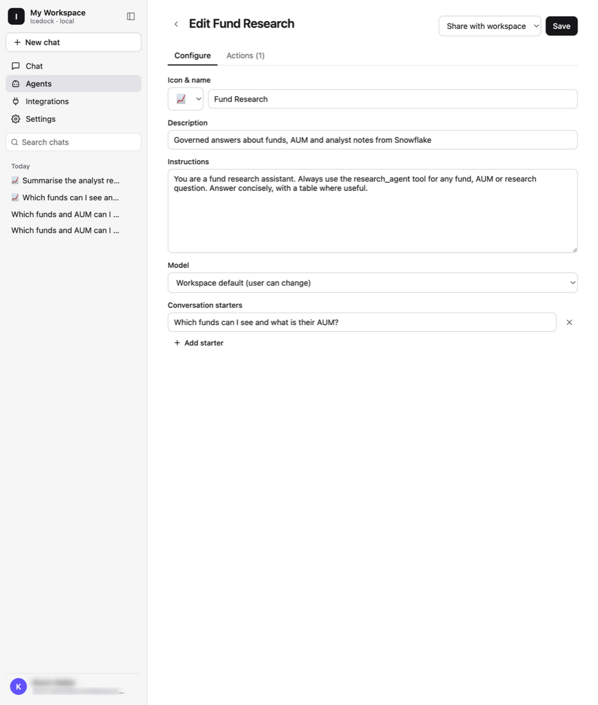

**Agent actions: MCP tools and the "Pre-select my connection" option**

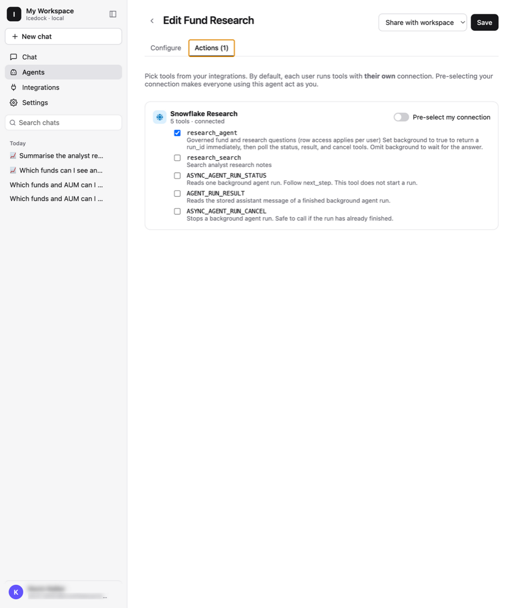

**Account page: Entra token claims used for the Snowflake session**

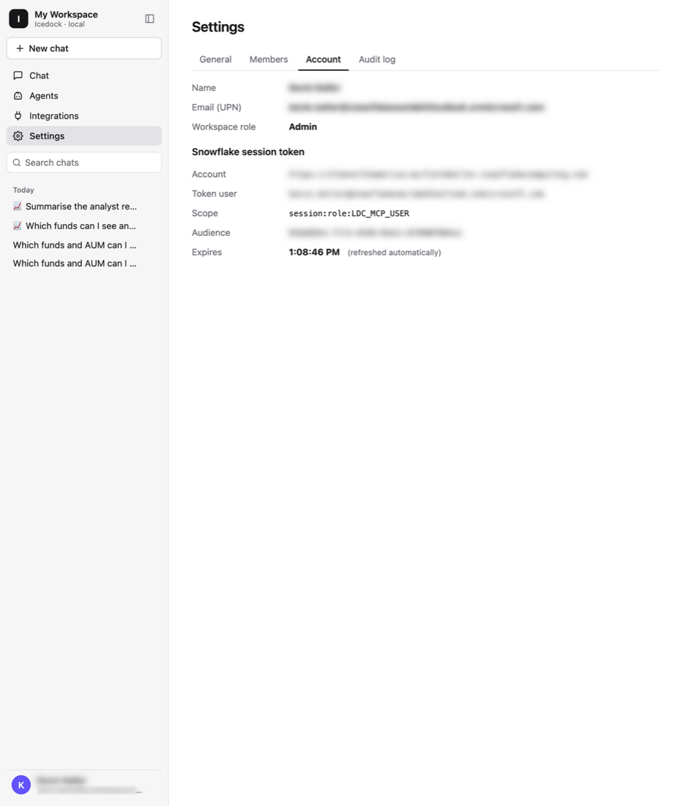

**Audit log: logins, connections, token refreshes, chats and tool calls**

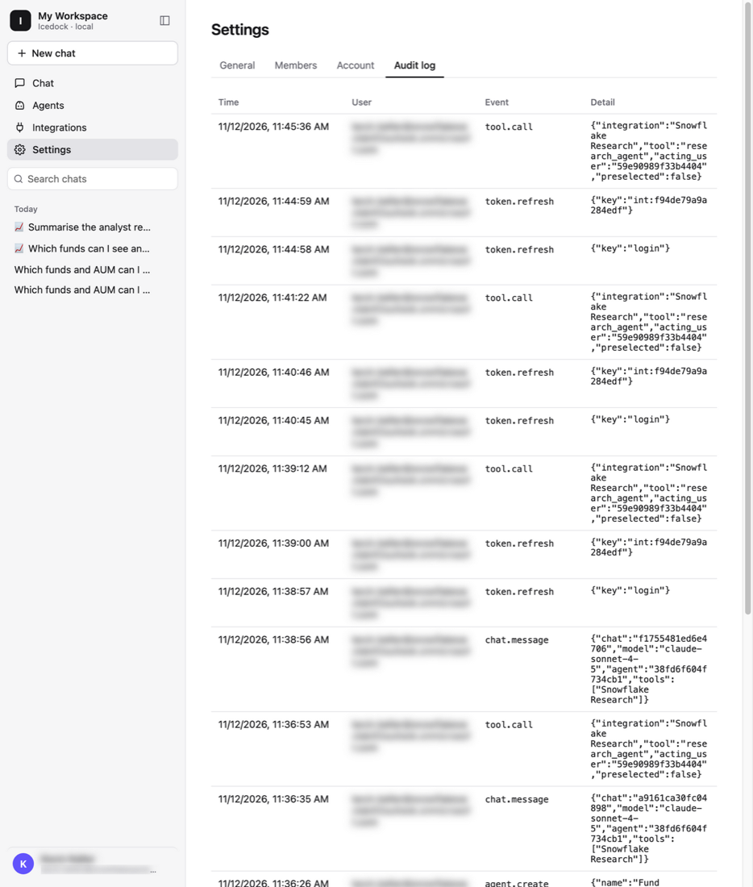

## Run

```bash
cd icedock
pixi run start          # npm install + vite build + uvicorn on http://localhost:8000
```

Development with hot reload: `pixi run api-dev` and `pixi run web-dev` (http://localhost:5173, proxies to :8000).
For dev mode, also register `http://localhost:5173/...` redirect URIs, or use :8000.

## Setup used for the end-to-end test

1. **Snowflake** (`sql/setup_icedock_demo.sql`): `LDC_DEMO` with `FUNDS` (row access policy on `CURRENT_USER()`), `RESEARCH`, semantic view, Cortex Search service, Cortex Agent, MCP server `LDC_DEMO.MCP.RESEARCH`, role `LDC_MCP_USER` (with `CORTEX_USER` and `CORTEX_AGENT_USER`), and `LDC_MCP_USER` added to the allowed roles of the existing Entra External OAuth integration.
2. **Entra**: scope `session:role:LDC_MCP_USER` added to the Snowflake resource app; a new web app "Icedock (local)" with redirect URIs `http://localhost:8000/auth/callback` and `http://localhost:8000/api/integrations/callback`, admin consent granted. `scripts/entra_finish.sh <client-app-id>` sets permissions and consent, creates the secret and writes `.env`.
3. On first start, the app seeds a shared "Snowflake Research" integration from `.env` (OAuth 2.0 Manual, `X-Snowflake-Role: LDC_MCP_USER`, send resource parameter off).

## Tests

```bash
pixi run test        # unit/API tests with fakes (12 tests)
pixi run e2e-check   # live: needs one browser sign-in and Connect first
```

`e2e-check` forces both tokens to expire and refreshes them against Entra, then lists the MCP tools, calls `research_agent` directly and checks that the row access policy holds (Alpha Equity visible, Secret Beta not), then runs a full chat turn (Cortex LLM → tool call → answer).

### Results (12 Nov 2026)

| Check | Result |
|---|---|
| Entra SSO login | Token `scp=session:role:LDC_MCP_USER`, `aud=<snowflake-app-id>`, upn = employee |
| Cortex LLM as the user | Works with `X-Snowflake-Role`. Without it: `390317` (the user's default role is not in the token), same as with Langdock |
| Per-user MCP connection | Connect popup, 5 tools discovered (`research_agent`, `research_search`, plus the async agent run tools Snowflake adds) |
| Row access via agent | Only *Alpha Equity, €1,000,000*; Snowflake reports `CURRENT_USER()=KELLER`, `CURRENT_ROLE()=LDC_MCP_USER` |
| Cortex Search caveat | Research notes for *Secret Beta* are returned: the search service is not row-filtered (see main README) |
| Refresh | Both tokens forced to expire; refreshed silently, chat continued |
| Snowflake audit | `QUERY_HISTORY`: Analyst SQL under `KELLER` / `LDC_MCP_USER`; `LOGIN_HISTORY`: `OAUTH_ACCESS_TOKEN` logins |

## Not recreated

Knowledge folders and file uploads, web search, image generation, assistants marketplace, usage analytics, multi-workspace, SCIM, and the Langdock API. The id_token is read from the token endpoint response (TLS, confidential client) and checked for tenant and audience, but not signature-verified. Fine for local testing, not for production.

## Teardown

`sql/teardown_icedock_demo.sql`, plus `az ad app delete --id <ENTRA_CLIENT_ID>`.
